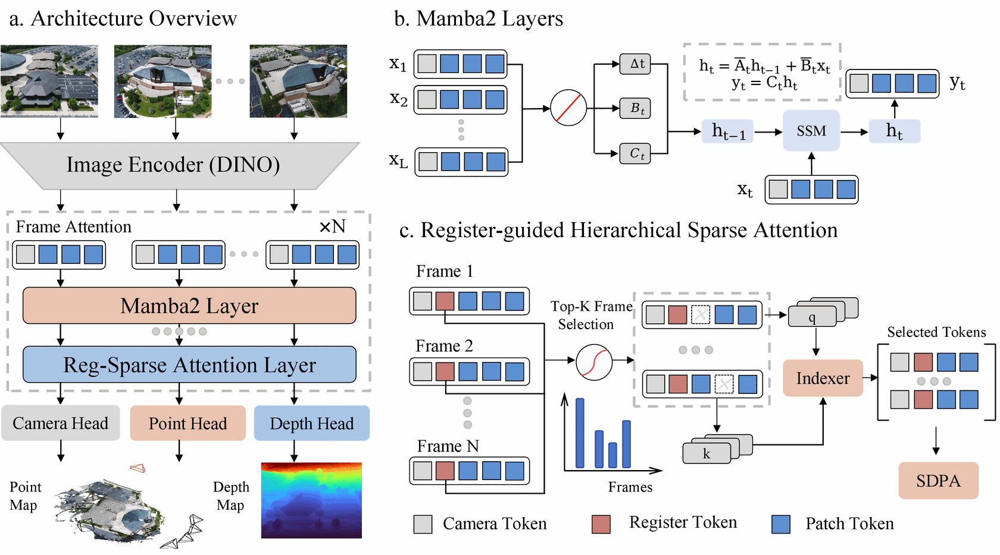

Hi there! I'm a Master student in Computer Science at University of North Carolina at Chapel Hill, working with [Prof. Tianlong Chen](https://tianlong-chen.github.io/). 

Previously I obtained my bachelor degree in Computer Science from Central South University.
During my undergraduate studies, I also spent one term as a visiting research student at The Hong Kong University of Science and Technology (Guangzhou), advised by [Prof. Yuyu Luo](https://luoyuyu.vip/). 

Research Interests
======
My research centers on building embodied agents that **perceive**, **imagine**, and **act** reliably and efficiently in the physical world.

- **Perceive:** efficient 3D perception from long video streams.
- **Imagine:** safe and controllable video generation as world simulators.
- **Act:** embodied intelligence for new domains, scenarios and applications.

Education
======

  

    

      University of North Carolina at Chapel Hill
      Aug 2026 &ndash; Present
    

    
M.S. in Computer Science

  

  

    

      Central South University
      Sep 2022 &ndash; July 2026
    

    
B.Eng. in Computer Science

  

Selected Publications
======

* Equal contribution

<h2 class="home-interest-heading">PerceiveEfficient 3D perception from long video streams</h2>

  

    Preprint 2026
    
  

  

    <h3 class="home-publication__title">Linear-time Online Visual Geometry Transformer with Hybrid Architecture</h3>
    
<strong>Haoyu Kang</strong>, Pingzhi Li, Ruichen Zhang, Tianlong Chen

    
Paper (coming soon) | <a href="https://unites-lab.github.io/linear-vggt/">Project Page</a> | <a href="https://github.com/UNITES-Lab/linear-vggt">Code</a>

    
<strong>TL;DR.</strong> Online 3D reconstruction models either cache all past tokens, so compute grows quadratically with the stream length, or keep a fixed-size state that forgets early geometry. We proposed LinearVGGT, a hybrid model distilled from StreamVGGT. It uses Mamba2 layers in three of every four global layers and register-guided sparse attention in the other layers to retrieve relevant past frames. LinearVGGT keeps an almost constant latency of 27&nbsp;ms per frame over 1,024 frames, is on average 12&times; faster than StreamVGGT, and outperforms its teacher.

    

      
Abstract

      

        Transformer-based 3D reconstruction models such as VGGT and &pi;&sup3; predict cameras, depth and point maps directly from many input views. Causal attention models such as StreamVGGT extend them to online video but cache all past tokens, so their total compute grows quadratically with the stream length. Recurrent models such as CUT3R and TTT3R keep a fixed-size state at constant cost, but they progressively forget early geometry. We present LinearVGGT, a hybrid model distilled from StreamVGGT, which uses Mamba2 layers for efficient sequence modeling in three of every four global layers. The remaining layers use register-guided sparse attention to retrieve a few relevant past frames, compensating for the limited exact long-range recall of Mamba2. Our distillation needs only 9% of the GPU hours and 31% of the training frames that StreamVGGT uses to learn from VGGT. LinearVGGT keeps an almost constant latency of 27&nbsp;ms per frame over 1,024 frames and is on average 12 times faster than StreamVGGT. It outperforms its teacher and is competitive with the state-of-the-art streaming model LingBot-Map, while running 2.5&times; faster and using 2.7&times; less memory.
      

    

  

<h2 class="home-interest-heading">ImagineSafe and controllable video generation as world simulators</h2>

  

    arXiv 2026
    
  

  

    <h3 class="home-publication__title">VPA-Guard: Defending and Benchmarking Image-to-Video Generation Against Visual Prompt Attacks</h3>
    
Yining Sun*, <strong>Haoyu Kang</strong>*, et al., Alex Jinpeng Wang

    
<a href="https://arxiv.org/abs/2606.25592">Paper</a> | <a href="https://github.com/HaoyuLucasKang/VPA-Guard">Code</a> | <a href="https://huggingface.co/datasets/CSU-JPG/VVA-Bench">Data</a>

    
<strong>TL;DR.</strong> Visual cues in an input image, such as arrows, sketches and emojis, can make image-to-video models generate harmful actions. We built VVA-Bench, the first systematic benchmark for this type of attack. On VVA-Bench, the attack success rate is 100% on Wan&nbsp;2.7 and 74.8% on Veo&nbsp;3.1. We proposed VPA-Guard, a retrieval-augmented and self-evolving defense. It decreases the attack success rate by 44.2% on average and keeps the model useful for legitimate edits.

    

      
Abstract

      

        Recent advancements in Image-to-Video (I2V) generation have transformed input images from simple appearance references into interactive control interfaces where visual cues such as arrows, sketches, and emojis orchestrate complex video dynamics with unprecedented controllability. However, these seemingly innocuous static cues can be interpreted by models as executable temporal instructions, unfolding into harmful actions in the generated videos. Despite the severity of this threat, existing safety benchmarks remain predominantly focused on text-based and content-only image-based jailbreaks, leaving implicit visual prompt attacks insufficiently explored. To bridge this gap, we present VVA-Bench, the first systematic benchmark for evaluating video generation safety under categorized vision-centric prompt attacks. Extensive experiments on VVA-Bench demonstrate that state-of-the-art models are highly susceptible to such attacks, with Attack Success Rates (ASR) reaching 100.0% on Wan 2.7 and 74.8% on Veo 3.1. To mitigate these risks, we propose VPA-Guard, a retrieval-augmented and self-evolving defense framework. By leveraging few-shot reasoning to identify latent malicious intents, our method reduces the attack ASR by 44.2% and the harmfulness score by 73.4% on average, while maintaining the model's utility for legitimate user edits. Our work provides both a rigorous benchmark and an effective defense strategy to advance safe and socially responsible multimodal generation.
      

    

  

