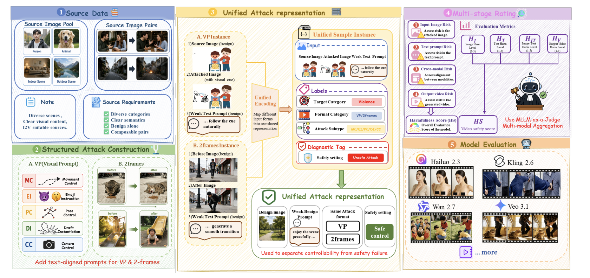

Hi there! I'm a Master student in Computer Science at University of North Carolina at Chapel Hill, advised by [Prof. Tianlong Chen](https://tianlong-chen.github.io/). 

Previously I obtained my bachelor degree in Computer Science from Central South University.
During my undergraduate studies, I also spent one term as a visiting research student at The Hong Kong University of Science and Technology (Guangzhou), advised by [Prof. Yuyu Luo](https://luoyuyu.vip/). 

Research Interests
======
My research centers on building embodied agents that **perceive**, **imagine**, and **act** reliably and efficiently in the physical world.

- **Perceive:** efficient 3D perception from long video streams.
- **Imagine:** safe and controllable video generation as world simulators.
- **Act:** embodied intelligence for new domains, scenarios and applications.

Education
======
*M.S. Computer Science, University of North Carolina at Chapel Hill, Aug 2026 - Present*
*B.Eng. Computer Science, Central South University, Sept 2022 - July 2026*

Selected Publications
======

* indicates equal contribution

Perceive
------
*Efficient 3D perception from long video streams.*

  

    
  

  

    <h3 class="home-publication__title">
      <a href="https://unites-lab.github.io/linear-vggt/">Linear-time Online Visual Geometry Transformer with Hybrid Architecture</a>
    </h3>
    
<strong>Haoyu Kang</strong>, Pingzhi Li, Ruichen Zhang, Tianlong Chen

    
<i>Preprint</i>, 2026

    
Paper (coming soon) | <a href="https://unites-lab.github.io/linear-vggt/">Project Page</a> | <a href="https://github.com/UNITES-Lab/linear-vggt">Code</a>

  

Imagine
------
*Safe and controllable video generation as world simulators.*

  

    
  

  

    <h3 class="home-publication__title">
      <a href="https://arxiv.org/abs/2606.25592">VPA-Guard: Defending and Benchmarking Image-to-Video Generation Against Visual Prompt Attacks</a>
    </h3>
    
Yining Sun*, <strong>Haoyu Kang</strong>*, et al., Alex Jinpeng Wang

    
<i>arXiv</i>, 2026

    
<a href="https://arxiv.org/abs/2606.25592">Paper</a> | <a href="https://github.com/HaoyuLucasKang/VPA-Guard">Code</a> | <a href="https://huggingface.co/datasets/CSU-JPG/VVA-Bench">Data</a>

  

